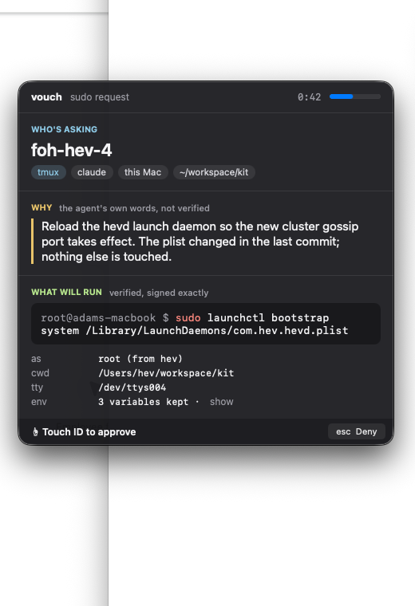
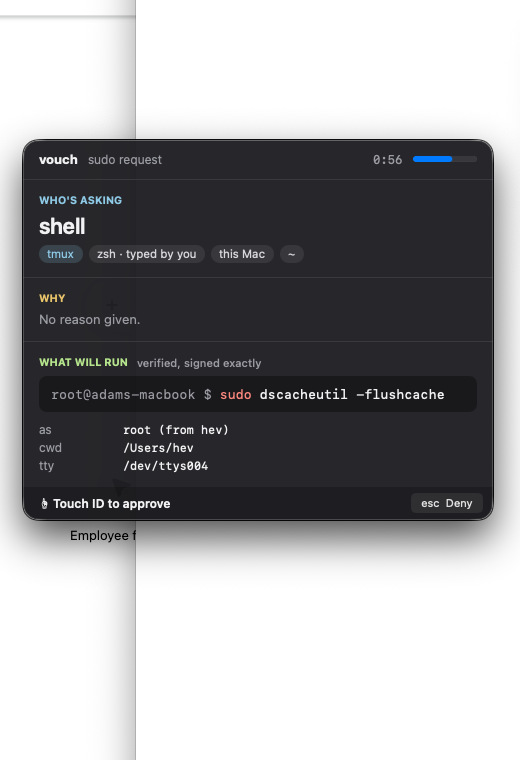

# Mac approvals

A Secure Enclave signature requires Touch ID. The Touch ID sheet belongs to
macOS: one line of text, capped at 160 characters. Vouch puts a short form
there, `<session> wants sudo <argv…>` (with `on <host>` for a remote host),
and shows the rest in a review panel beside the sheet. The complete command
and environment remain bound to the signature whatever either one displays.

Contextual PAM approvals authenticate a sudo session; their command context
is advisory. See [the mode comparison](local-sudo.md#sudo-authentication-through-pam).

## The review panel

The panel opens when the agent takes the one-sheet-at-a-time permit, just
before the sheet appears, and closes when the sheet is answered, dismissed,
cancelled or expires. It answers three questions in order:

| Section | Shows | Comes from |
| --- | --- | --- |
| Who's asking | The session as the headline; chips for tmux or headless, the harness or shell, the host (`remote · <host>` when it is not this Mac), and the cwd | `session` (from `VOUCH_SESSION`), `pid_chain`, `host`, `cwd`, `tty` |
| Why | The agent's own words, labelled "not verified", or "No reason given." | `reason` (from `VOUCH_REASON`) |
| What will run | `user@host $ sudo argv…`, run-as user, cwd, tty, and the bound environment (collapsed) | The signed request |

For a contextual PAM request (sudo-rs on a remote host) the "What" block says
that Touch ID authenticates the sudo session rather than signing the exact
command. For a Claude Code or Codex permission request it shows the tool: the
Bash command, the file and diff for Edit or Write, the URL for WebFetch.

There is no Approve button: Touch ID on the sheet approves. Esc or Deny in the
panel cancels the attempt, which is a denial like dismissing the sheet. A
countdown runs to the request's deadline. All text is escaped before it is
drawn.

Try it with nothing in flight:

```sh
vouch-agent preview-panel --fixture local-sudo      # also: oven-headless, claude-edit, no-reason
vouch-agent preview-panel --fixture no-reason --print
```

Set `VOUCH_PANEL=0` in the agent's environment (the LaunchAgent plist) to
turn the panel off.

| Local tmux sudo | Headless on Oven | Claude Edit | No reason |
| --- | --- | --- | --- |
|  |  |  |  |

### Session and reason variables

`VOUCH_SESSION` names the session. Export it once per shell, for example from
tmux: `export VOUCH_SESSION="$(tmux display -p '#S')"`. `OSHIOKI_SESSION` is
still read for one release when `VOUCH_SESSION` is unset.

`VOUCH_REASON` carries the agent's reason for one command, for example from
a Claude Code PreToolUse hook that copies the Bash tool's `description`.
Both are read by the sudo plugin from the invoking environment before
`env_reset`, never from the environment the command runs with. A reason is
at most 500 characters with no control characters; anything else is dropped.
It is display text only and never affects what is verified or executed.

## Start at login

For a Mac whose own sudo is configured, use `vouch-laptop-setup` in the
[local](local-sudo.md) or [remote](remote-sudo.md) setup. It manages:

- `~/Library/LaunchAgents/com.hev.vouch.agent.plist`
- `~/.config/vouch/agent.log`

It verifies the packaged agent and uses Homebrew's stable `opt` path, so an
upgrade followed by cleanup does not break the next login.

For an approval-only Mac using a source checkout, pair it first and load its
device-role NATS environment, then:

```sh
scripts/mac/install-agent
```

This separate installer manages `dev.hev.vouch.agent` and logs to
`~/Library/Logs/vouch-agent.log`. It requires NATS and builds the app bundle
if needed. `--dry-run` previews a redacted plist; `--uninstall` removes this
LaunchAgent. Re-run it after rebuilding. Use only one installer/agent for an
identity at a time.

Check the service you installed:

```sh
launchctl print gui/$(id -u)/com.hev.vouch.agent
vouch-agent show
tail -f ~/.config/vouch/agent.log
```

For the source installer, substitute `dev.hev.vouch.agent` and its log path.

## Prompts and recovery

Only one Touch ID sheet can run at a time. A locked screen
cannot complete approval, and the request deadline ends an unanswered prompt.
Cancellation never approves a request. PAM cancellation leaves password
fallback available; command approval fails closed without a valid decision.

Set `OSHIOKI_SESSION` in the invoking shell to label requests. Without it the
summary uses a recognizable caller process or tty when available.

Adding or removing a Touch ID fingerprint invalidates the existing enclave
key. Retrying cannot repair that key: follow
[re-pairing](../RUNBOOK.md#re-pairing), then update every host that pinned it.

Identity creation and loading need the user's unlocked login keychain.
`User interaction is not allowed` usually means setup is running outside
that graphical session. Run setup in a Terminal window on the Mac.

For bundle signing and release checks, see [contributing](../CONTRIBUTING.md).
